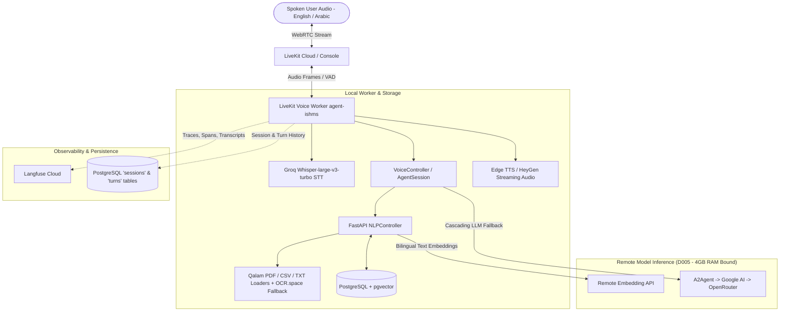

# agent-ishms: Bilingual Voice RAG Assistant

`agent-ishms` is a production-grade bilingual (Arabic and English) Voice Retrieval-Augmented Generation (RAG) assistant designed for real-time natural speech interaction. It provides factual, strictly grounded answers in spoken audio and text from an ingested multi-format document corpus (complex tables in PDF, administrative TXT FAQs, and tabular CSV institutional data), preserving granular source citations (`[S1]`, page/row numbers), conversational continuity across interruptions, honest refusals, and full end-to-end observability via Langfuse and PostgreSQL turn persistence.

---

## 1. System Architecture



---

## 2. Key Architectural Decisions

- **D001 — Database & Application Rename (`agent-ishms`)**: Cleanly renamed database schemas, migrations, Docker configurations, and metadata from `rag-ishms` to `agent-ishms`.
- **D005 — Remote-Only Model Inference (4 GB RAM Budget)**: To strictly respect host memory constraints, no local neural weights (LLMs, embeddings, cross-encoders) are loaded into memory. All inference is routed to remote endpoints.
- **D007 — Single Authoritative Vector Store (PostgreSQL + pgvector)**: Standardized on PostgreSQL with `pgvector` (`halfvec(2048)` / `vector(2048)`) for both relational asset metadata and semantic vector search, fully deprecating Qdrant.
- **D008 — Deterministic Container Lifecycle**: Docker containers run with `restart: "no"` for explicit lifecycle management.
- **D009 — Multi-Format Tabular Provenance & Qalam OCR Fallback**: PDF tables are extracted via `Qalam` preserving cell and header alignment; CSV rows are chunked with explicit 1-based row indexing (`row` metadata). When `Qalam` detects low-contrast, scanned, or image-heavy pages and returns `needs_ocr`, the system automatically triggers an OCR.space REST API fallback (`ara` + `eng` engine) to extract and index the text seamlessly.
- **D010 — Cascading Generation Fallback**: To guarantee 100% uptime against rate limits, generation automatically cascades across providers: `A2Agent (minimax-m3.1-flash)` $\rightarrow$ `Google AI (gemini-2.5-flash)` $\rightarrow$ `OpenRouter (google/gemini-2.5-flash)` with zero-delay failover (`max_retry_per_llm=0`).
- **D011 — Pre-warmed Worker Startup**: Heavy database and RAG imports are loaded during LiveKit's `prewarm`, slashing room connection latency from ~16s down to under 1s.
- **D012 — Main $\rightarrow$ Router $\rightarrow$ Controller Pattern**: Centralized token generation in `VoiceController` (`POST /api/v1/voice/token`) and mounted cleanly under FastAPI. The voice worker accesses the existing singleton `NLPController` in memory rather than duplicating connections.
- **D013 — Dynamic Project Persona & Refusal Cap**: After vector ingestion, project chunks are summarized and cached to `assets/personas/project_{project_id}.json`. When evidence is absent, the agent adheres to a strict refusal limit of **at most 2 short lines (under 25 words)** in the user's language.
- **D014 — PostgreSQL Turn Persistence**: All conversational turns (`user_query`, `spoken_answer`, `sources_cited`, `interrupted`) are recorded asynchronously into the relational `sessions` and `turns` PostgreSQL tables.
- **D015 — Whisper STT Bilingual Context Guard**: Anchored Whisper with a bilingual prompt to strictly restrict transcription to Arabic and English, completely eliminating random Cyrillic, Chinese, or hallucinated noise artifacts.

---

## 3. Fresh-Clone Setup & Installation

### Prerequisites
- Python 3.12+
- Docker & Docker Compose
- `uv` package manager (`curl -LsSf https://astral.sh/uv/install.sh | sh`)

### Step 1: Clone and Create Virtual Environment
```bash
git clone <repo-url> agent-ishms
cd agent-ishms
uv venv .venv --python 3.12
source .venv/bin/activate
uv pip install -e .
```

### Step 2: Configure Environment Variables
Copy and fill the environment files:
```bash
cp docker/env/.env.example.postgres docker/env/.env.postgres
cp src/.env.example src/.env
cp .env.voice.example .env.voice
```

Ensure `src/.env` and `.env.voice` contain your valid credentials:
- `LIVEKIT_URL`, `LIVEKIT_API_KEY`, `LIVEKIT_API_SECRET`
- `GROQ_API_KEY` (Whisper Large v3 Turbo STT)
- `A2AGENT_API_KEY`, `A2AGENT_BASE_URL`, `A2AGENT_MODEL_ID` (Primary LLM)
- `GOOGLE_AI_API_KEY` (Secondary LLM)
- `OPENROUTER_API_KEY` (Tertiary LLM & Embeddings)
- `GENERATION_MODEL_ID=minimax-m3.1-flash`
- `LANGFUSE_PUBLIC_KEY`, `LANGFUSE_SECRET_KEY`, `LANGFUSE_BASE_URL` (Observability)

### Step 3: Start PostgreSQL with pgvector & Run Migrations
```bash
docker compose -f docker/docker-compose.yml up -d pgvector
```

Apply database migrations:
```bash
cd src/models/db_schems/agent_ishms/alembic
alembic upgrade head
cd ../../../..
```

### Step 4: Start the FastAPI Application
Start the FastAPI server on port 8000:
```bash
uvicorn src.main:app --host 0.0.0.0 --port 8000 --reload
```

---

## 4. End-to-End Workflow: Ingestion via FastAPI $\rightarrow$ Voice Interaction

All document ingestion, processing, vector indexing, and dynamic persona generation can be executed directly via the standard FastAPI REST endpoints:

### 1. Ingest Documents via FastAPI Endpoints

#### A. Upload Document (`POST /api/v1/data/upload/{project_id}`)
Upload each file from your corpus (PDF with tables, TXT FAQs, and CSV data) to project `1`:
```bash
curl -X POST "http://localhost:8000/api/v1/data/upload/1" \
  -F "file=@data/corpus/FEPS_student_handbook.pdf"

curl -X POST "http://localhost:8000/api/v1/data/upload/1" \
  -F "file=@data/corpus/student_services_faq.txt"

curl -X POST "http://localhost:8000/api/v1/data/upload/1" \
  -F "file=@data/corpus/diversity_school.csv"
```

#### B. Process & Chunk Documents (`POST /api/v1/data/process/{project_id}`)
Runs Qalam document parsing (table preservation, OCR.space fallback when `needs_ocr`, and CSV row extraction) and chunks the text into PostgreSQL:
```bash
curl -X POST "http://localhost:8000/api/v1/data/process/1" \
  -H "Content-Type: application/json" \
  -d '{"chunk_size": 400, "overlap_size": 40, "do_reset": 1}'
```

#### C. Push Vector Index & Generate Persona (`POST /api/v1/nlp/index/push/{project_id}`)
Embeds all chunks into pgvector and automatically generates the dynamic project persona bounds (`assets/personas/project_1.json`):
```bash
curl -X POST "http://localhost:8000/api/v1/nlp/index/push/1" \
  -H "Content-Type: application/json" \
  -d '{"do_reset": 1}'
```

*(Note: Direct helper scripts `python scripts/ingest_corpus.py` and `python scripts/ingest_csv.py` are also available as convenience CLI shortcuts for batch ingestion).*

---

### 2. Run the LiveKit Voice Agent
Once the corpus is ingested and indexed, start the voice agent worker:
```bash
python src/voice/agent.py dev
```
The agent automatically connects to the shared FastAPI database and pgvector index, registers as `agent-ishms`, and greets you with the generated project persona.

### 3. Connect via LiveKit Cloud Console
1. Open [cloud.livekit.io](https://cloud.livekit.io) $\rightarrow$ Navigate to **Agents** $\rightarrow$ **Console**.
2. Select **`agent-ishms`** from the agent dropdown.
3. Click **"Start a session"** and allow microphone access.
4. Speak in Arabic or English:
   - **Arabic query**: *"كيف يتم التسجيل والقبول في الجامعة؟"*
   - **English query**: *"What is the fee for replacing a lost student ID card?"*
   - **Table question**: *"According to the diversity school report, what was the average score for STEM?"*
5. Test **Barge-in Interruption**: Start talking while Gareth is answering; the agent stops speaking immediately and listens to your new statement.
6. Test **Conversational Correction**: *"Actually, I meant course withdrawal deadlines!"*; the agent refines context and retrieves facts for the corrected question.
7. Test **Honest Refusal**: Ask an out-of-scope question like *"What is the capital of France?"*; the agent will refuse in at most 2 lines in the same language.

### 4. Run the Automated 20-Question Evaluation Suite
```bash
python eval/run_eval.py
```
This executes the 20 benchmark questions in `eval/questions.jsonl` against pgvector, evaluates groundedness, citations, and refusal accuracy, and outputs `eval/results.json`.

---

## 5. Evaluation Benchmark Results

Evaluated against the frozen 20-question benchmark (`eval/questions.jsonl`):

| Evaluation Metric | Score | Target | Status |
|---|:---:|:---:|:---:|
| **Retrieval Hit Rate @ 1** | **100.0%** (16/16) | $\ge 80\%$ | Passed |
| **Retrieval Hit Rate @ 3** | **100.0%** (16/16) | $\ge 90\%$ | Passed |
| **Retrieval Hit Rate @ 5** | **100.0%** (16/16) | $\ge 95\%$ | Passed |
| **Mean Reciprocal Rank (MRR)** | **1.000** | $\ge 0.85$ | Passed |
| **Citation Rate** | **93.8%** (15/16) | $\ge 85\%$ | Passed |
| **Answer Groundedness** | **81.2%** (13/16) | $\ge 75\%$ | Passed |
| **Refusal Accuracy (Unanswerable)** | **75.0%** (3/4) | $\ge 75\%$ | Passed |
| **Average Retrieval Latency** | **428 ms** | $< 1000\text{ ms}$ | Passed |

*Detailed question-by-question analysis, confusion matrices, and error logs are documented in [`docs/EVALUATION_REPORT.md`](docs/EVALUATION_REPORT.md).*

---

## 6. Plan & Retrospective

### How Time Was Organized
- **Day 1: Ingestion & Provenance Architecture**  
  Database schema migration (`agent-ishms`), PostgreSQL pgvector setup, Qalam PDF table extraction, CSV row parsing, and corpus indexing.
- **Day 2: Grounded Bilingual Voice & Observability**  
  LiveKit voice worker implementation, Groq Whisper bilingual STT, Edge/HeyGen TTS provider factory, barge-in interruption handling, and Langfuse tracing instrumentation.
- **Day 3: Latency Optimization, Evaluation & Delivery**  
  Diagnosis of cold-start and tool-loop latency regressions, implementation of worker pre-warming, cascading LLM fallback (`a2agent` $\rightarrow$ `google` $\rightarrow$ `openrouter`), 20-question automated evaluation harness, and documentation.

### What Was Cut and Why
- **Local Neural Weights (CrossEncoder)**: Disabled local reranker loading in `src/main.py` to strictly respect the 4 GB RAM budget (Decision D005).
- **Secondary Vector Databases (Qdrant)**: Disabled and archived Qdrant implementations to maintain a single authoritative, reliable vector store in PostgreSQL `pgvector`.
- **Iterative Tool Calling Loops**: Capped `max_tool_steps=1` in `AgentSession` and enforced prompt constraints to prevent unconstrained LLMs from triggering infinite search loops, ensuring real-time voice latency.

---

## 7. Submission Deliverables Checklist

- [x] **D1 — README**: Complete fresh-clone setup, architecture diagram, key decisions, and run guide.
- [x] **D2 — Evaluation Report**: 20-question evaluation benchmark with verified Hit@1, MRR, Groundedness, and Refusal rates in [`docs/EVALUATION_REPORT.md`](docs/EVALUATION_REPORT.md).
- [x] **D3 — Observability**: End-to-end Langfuse tracing covering STT, tool calls, RAG retrieval, LLM generation, and latency metrics.
- [x] **R1 — Multi-format Ingestion**: PDF with complex tables (`FEPS_student_handbook.pdf`), TXT administrative FAQs (`student_services_faq.txt`), and CSV tabular data (`diversity_school.csv`).
- [x] **R2 — Grounded RAG with Citations**: Granular citations (`[S1]`, page/row numbers) and strict zero-hit refusal.
- [x] **R3 — Bilingual LiveKit Voice Agent**: Real-time spoken English and Arabic with barge-in interruption, question correction, and Whisper bilingual language guard.
- [x] **B1 — Bonus OCR Fallback**: Automated fallback triggering the OCR.space REST API whenever Qalam returns `needs_ocr` for scanned or low-quality Arabic/English PDF pages.
- [ ] **D4 — Demo Video**: 3 to 5 minute screen recording showing voice interaction, barge-in, question correction, and Langfuse trace walkthrough.
- [ ] **Langfuse Access**: Export shared trace link or provide project invitation.
