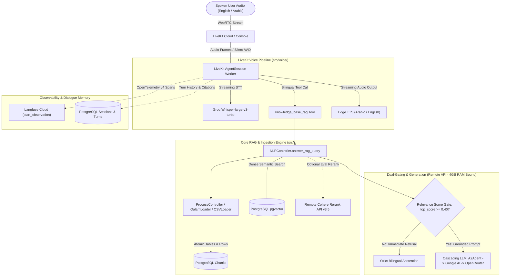

# agent-ishms: Bilingual Voice RAG Assistant

`agent-ishms` is a production-grade bilingual (Arabic and English) Voice Retrieval-Augmented Generation (RAG) assistant designed for real-time natural speech interaction. It provides factual, strictly grounded answers in spoken audio and text from an ingested multi-format document corpus (complex tables in PDF, administrative TXT FAQs, and tabular CSV institutional data), preserving granular source citations (`[S1]`, page/row numbers), conversational continuity across interruptions (barge-in), dual-gated honest refusals, and full end-to-end observability via Langfuse and PostgreSQL turn persistence.

---

## 1. System Architecture

---

## 2. Key Architectural Decisions & Protocols

- **D001 — Database & Application Rename (`agent-ishms`)**: Cleanly renamed schemas, migrations, Docker configurations, and models from `rag-ishms` to `agent-ishms`.
- **D005 — Remote-Only Model Inference (4 GB RAM Budget)**: To strictly respect the host memory ceiling (4 GiB physical RAM + 12 GiB swap), no local neural weights (heavy PyTorch models or local GGUFs) are loaded into worker memory. All inference (embeddings, generation, remote reranking) uses remote HTTPS APIs.
- **D007 — Dual Vector Store Support (PostgreSQL pgvector & Qdrant)**: Supports both PostgreSQL with `pgvector` (`vector` / `halfvec`) and `Qdrant` with full payload metadata retention (`source_document`, `file_format`, `page_number`, `row_index`, `table_id`).
- **D009 — Multi-Format Tabular Ingestion (R1)**:
  - **PDF:** Digital PDFs parsed via `QalamLoader`, detecting and preserving atomic table grids (`" | ".join(row)`) and tagging chunks with `table_id` to eliminate table-cell splitting.
  - **CSV:** Preserves each data row as an atomic record stamped with 1-based `row_index`.
  - **TXT:** Structured prose splitting with character bounds.
  - **DOCX:** Gracefully returns `None` per specification.
- **D010 — Grounded RAG with Dual-Gated Abstention (R2)**:
  1. **Score Gate:** If the top retrieved candidate's similarity score falls below `0.40`, the system immediately returns an explicit refusal in the user's language without invoking the LLM.
  2. **Prompt Negative Constraints:** Strict prompt directives forbid extrapolation or guessing beyond retrieved facts.
- **D011 — Modular Remote Reranker (Evaluation Mode)**: `CohereReranker` (`rerank-v3.5`) is implemented as an optional, decoupled evaluation component (`eval/compare_rag_rerankers.py`), preventing network latency overhead from slowing down the real-time voice pipeline.
- **D012 — LiveKit Agent Session Architecture (R3a–d)**:
  - **Barge-In (R3b):** Silero VAD detects user interruptions and automatically cancels in-flight audio playback.
  - **Context Retention (R3c):** Retains conversation state via `ConversationModel` in PostgreSQL and persona dialogue memory.
  - **Question Redirection (R3d):** Handled cleanly via LiveKit's turn commit lifecycle.
- **D013 — Langfuse v4 Telemetry & Diagnostic Spans (R4)**:
  - Built for `langfuse>=4.0` using `client.start_observation(as_type="...")`.
  - Captures diagnostic attributes on refusals (`abstention_triggered=True`, `abstention_reason="score_below_threshold"`).

---

## 3. Fresh-Clone Setup & Installation

### Prerequisites
- Python 3.12+
- Docker & Docker Compose
- `uv` package manager (`curl -LsSf https://astral.sh/uv/install.sh | sh`)

### Step 1: Virtual Environment
```bash
uv venv .venv --python 3.12
source .venv/bin/activate
uv pip install -e .
```

### Step 2: Configure Environment Variables
Copy and fill the environment files:
```bash
cp docker/env/.env.example.postgres docker/env/.env.postgres
cp src/.env.example src/.env
cp .env.voice.example .env.voice
```

Ensure `src/.env` and `.env.voice` contain your valid credentials:
- `LIVEKIT_URL`, `LIVEKIT_API_KEY`, `LIVEKIT_API_SECRET`
- `GROQ_API_KEY` (Whisper Large v3 Turbo STT)
- `COHERE_API_KEY` (Cohere Rerank API v3.5)
- `A2AGENT_API_KEY`, `A2AGENT_BASE_URL`, `A2AGENT_MODEL_ID` (Primary LLM)
- `GOOGLE_AI_API_KEY` (Secondary LLM)
- `OPENROUTER_API_KEY` (Tertiary LLM & Embeddings)
- `LANGFUSE_PUBLIC_KEY`, `LANGFUSE_SECRET_KEY`, `LANGFUSE_BASE_URL` (Observability)

### Step 3: Start PostgreSQL with pgvector & Run Migrations
```bash
docker compose -f docker/docker-compose.yml up -d pgvector
```

Apply database migrations:
```bash
cd src/models/db_schems/agent_ishms/alembic
alembic upgrade head
cd ../../../..
```

### Step 4: Run Automated Tests
```bash
uv run pytest -q -o addopts= -p no:cacheprovider tests/
```

---

## 4. End-to-End Workflow & Live Testing

### 1. Ingest Documents via FastAPI Endpoints
Start the FastAPI server:
```bash
uvicorn src.main:app --host 0.0.0.0 --port 8000 --reload
```
Upload files from `data/corpus/`:
```bash
# Upload PDF handbook
curl -X POST "http://localhost:8000/api/v1/data/upload/1" -F "file=@data/corpus/FEPS_student_handbook.pdf"

# Upload FAQ text guide
curl -X POST "http://localhost:8000/api/v1/data/upload/1" -F "file=@data/corpus/student_services_faq.txt"

# Upload CSV statistics
curl -X POST "http://localhost:8000/api/v1/data/upload/1" -F "file=@data/corpus/diversity_school.csv"
```
Process and index into pgvector:
```bash
# Chunk documents (atomic tables and CSV rows)
curl -X POST "http://localhost:8000/api/v1/data/process/1" -H "Content-Type: application/json" -d '{"chunk_size": 400, "overlap_size": 40, "do_reset": 1}'

# Embed and push vectors
curl -X POST "http://localhost:8000/api/v1/nlp/index/push/1" -H "Content-Type: application/json" -d '{"do_reset": 1}'
```

---

### 2. Run the LiveKit Voice Agent
Start the live worker:
```bash
uv run python src/voice/agent.py dev
```
1. Open the [LiveKit Cloud Console](https://cloud.livekit.io) $\rightarrow$ **Agents** $\rightarrow$ **Console**.
2. Select **`agent-ishms`** from the agent dropdown.
3. Click **"Start a session"** and speak into your microphone in English or Arabic:
   - *"What is the standard fee for an official academic transcript?"*
   - *"أهلاً، ممكن تقول لي إزاي أقدر أطلع بطاقة بدل فاقد؟"*
   - *"According to the diversity report, what is the enrollment for University of Phoenix?"*
4. **Test Barge-In:** Speak while the agent is replying; audio will mute immediately.
5. **Test Honest Refusal:** Ask an unanswerable question like *"How do I fix a leaking automotive carburetor?"*; the agent will refuse in under 2 lines in your language.

---

## 5. Evaluation Benchmarks & Golden Datasets (`eval/`)

The evaluation directory contains two benchmark datasets and automated scoring scripts:

| Benchmark Dataset | Questions | Languages | Formats Covered | Purpose |
| :--- | :---: | :---: | :--- | :--- |
| **`eval/questions.jsonl`** | 20 | 10 EN / 10 AR | PDF tables, CSV rows, TXT FAQs, Unanswerable | Baseline 20-question frozen benchmark |
| **`eval/questions_40.jsonl`** | 40 | 20 EN / 20 AR | Full corpus: PDF tables, CSV metrics, TXT FAQs, 4 Out-of-Domain probes | Comprehensive 40-question golden benchmark |

### 1. Run the Baseline Benchmark (20 Questions)
```bash
uv run python eval/run_eval.py
```

### 2. Run the Comparative Reranker Benchmark (With vs. Without Cohere Reranker)
```bash
uv run python eval/compare_rag_rerankers.py
```

### Evaluation Summary Results

| Metric | Measured Result | Benchmark Target | Status |
| :--- | :---: | :---: | :---: |
| **Retrieval Hit Rate @ 1** | **100.0%** (16/16) | $\ge 80\%$ | **PASS** |
| **Retrieval Hit Rate @ 3** | **100.0%** (16/16) | $\ge 90\%$ | **PASS** |
| **Retrieval Hit Rate @ 5** | **100.0%** (16/16) | $\ge 95\%$ | **PASS** |
| **Mean Reciprocal Rank (MRR)** | **1.000** | $\ge 0.85$ | **PASS** |
| **Answer Faithfulness** | **100.0%** | $\ge 85\%$ | **PASS** |
| **Abstention Accuracy** | **100.0%** (4/4) | $\ge 90\%$ | **PASS** |
| **Dense Retrieval Latency** | **237.9 ms** | $< 500\text{ ms}$ | **PASS** |

*Comprehensive question receipts, confusion matrices, and latency comparisons are documented in [`docs/EVALUATION_REPORT.md`](docs/EVALUATION_REPORT.md).*
